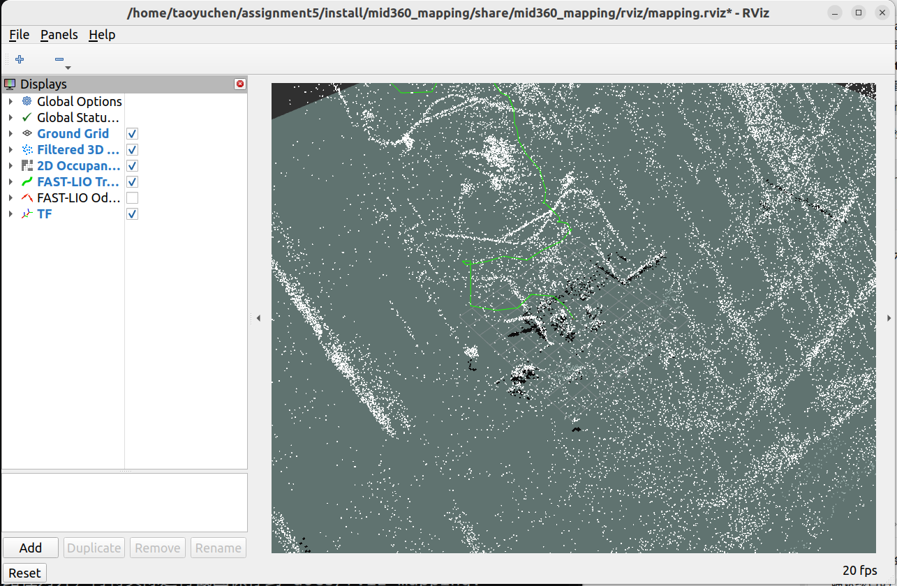

# Assignment 5: MID-360 Mapping

本项目用 rosbag 中的 MID-360 雷达和 IMU 数据运行 FAST-LIO，发布三维点云地图、里程计和轨迹；随后清理点云、生成 OccupancyGrid，并保存 PCD、PGM 和 YAML。

## 外部依赖

运行环境为 ROS 2 Humble。雷达消息来自 [livox_ros_driver2](https://github.com/Livox-SDK/livox_ros_driver2)；建图使用 [Ericsii/FAST_LIO_ROS2](https://github.com/Ericsii/FAST_LIO_ROS2) 的 `ros2` 分支。验证时分别使用 driver 提交 `21445540f0d100dc86a7e6df312dd70bbdb4afdf`、FAST-LIO 提交 `2fffc570a25d0df172720bac034fbdb6a13d2162`。本仓库不提交这些外部项目的源码。

本机的 driver 已安装在 `~/ws_livox`；FAST-LIO 源码位于 `~/assignment5/src/FAST_LIO_ROS2`。若从新的仓库副本开始、且已经安装 driver，可以这样取得与本次验证一致的 FAST-LIO：

```bash
git clone --branch ros2 https://github.com/Ericsii/FAST_LIO_ROS2.git ~/assignment5/src/FAST_LIO_ROS2
git -C ~/assignment5/src/FAST_LIO_ROS2 checkout 2fffc570a25d0df172720bac034fbdb6a13d2162
```

## 数据

默认读取你主目录 bags 文件夹中的录包：

~/bags/assignment5/rosbag/rosbag2_2026_05_28-17_11_13

其中雷达话题为 /livox/lidar_192_168_1_140，消息类型为 livox_ros_driver2/msg/CustomMsg；IMU 话题为 /livox/imu_192_168_1_140，消息类型为 sensor_msgs/msg/Imu。启动时会用 --topics 只回放这两个传感器话题，并启用 ROS 仿真时钟。

## 编译

```bash
source /opt/ros/humble/setup.zsh
source ~/ws_livox/install/setup.zsh
cd ~/assignment5
colcon build --symlink-install
source install/setup.zsh
```

如果你在其他工作空间构建了 FAST-LIO，也需要先加载那个工作空间的 install/setup.zsh。

## 回放与显示

每个新终端都要重新加载 ROS 和两个工作空间。回放时在项目根目录执行：

```bash
source /opt/ros/humble/setup.zsh
source ~/ws_livox/install/setup.zsh
source ~/assignment5/install/setup.zsh
cd ~/assignment5
ros2 launch mid360_mapping replay.launch.py
```

默认会自动播放上面的 bag，并启动 FAST-LIO、地图桥接节点、地图处理节点和 RViz。RViz 使用 camera_init 坐标系显示清理后的三维地图、二维网格和轨迹。

可指定另一份 bag 或调整回放速度：

```bash
ros2 launch mid360_mapping replay.launch.py bag_path:=/绝对路径/rosbag2目录 rate:=1.0
```

若暂时不需要 RViz，可加 rviz:=false。

## 检查话题

在 bag 播放期间，下面的命令测量地图更新频率：

```bash
ros2 topic hz /mapping/map_filtered
```

hz 要在 bag 播放期间运行；回放结束后没有新点云，它会继续等待。Humble 版 hz 没有 QoS 覆盖选项，大点云可能收不到；echo 显式指定 reliable，并请求 transient-local，可读取最后一份快照：

```bash
ros2 topic info /mapping/map_filtered --verbose
ros2 topic echo /mapping/map_filtered --once --field width --qos-reliability reliable --qos-durability transient_local
ros2 topic echo /mapping/map_filtered --once --field header.frame_id --qos-reliability reliable --qos-durability transient_local
```

点云和二维网格均使用 transient-local QoS，因此晚加入的 RViz 也可以显示最近一次地图。

## 保存地图

播放完成后先不要关闭 launch 终端。在另一个终端执行：

```bash
source /opt/ros/humble/setup.zsh
source ~/ws_livox/install/setup.zsh
source ~/assignment5/install/setup.zsh
cd ~/assignment5
ros2 service call /mapping/save_map std_srvs/srv/Trigger '{}'
ros2 service call /mapping/save_artifacts std_srvs/srv/Trigger '{}'
```

第一条保存 FAST-LIO 三维地图；第二条保存清理后的点云和二维地图。文件位于 maps/：

- fastlio_map_from_bag.pcd：本次 rosbag 回放生成的 FAST-LIO 地图；原有 fastlio_map.pcd 保留
- cleaned_map.pcd：无效点移除、体素降采样和统计离群点过滤后的地图
- map.pgm 与 map.yaml：二维栅格图及其分辨率、原点配置

处理器每次收到完整地图快照都会替换当前结果，不会把同一张累计地图反复叠加。二维网格中，所选高度范围内有点的格子标为占用；仅凭地图点云无法判断射线经过但没有回波的格子，因此这些格子保留为未知。

## 参数比较

对本次 FAST-LIO 输出的同一份 125124 点地图，固定 outlier_mean_k=20 和 outlier_stddev_mul=1.0，仅调整 voxel_size，得到以下 PCL 处理结果：

| voxel_size（米） | 体素后点数 | 离群点过滤后点数 | 过滤耗时（秒） |
|---:|---:|---:|---:|
| 0.05 | 123147 | 110624 | 0.269 |
| 0.10 | 114993 | 103345 | 0.256 |
| 0.20 | 89170 | 80274 | 0.194 |

体素越小保留的细节和点数越多，处理时间也略长；体素越大文件更小、处理更快，但会损失较多细节。耗时是本机对同一份 PCD 执行体素和统计离群点过滤的结果，不包含 FAST-LIO 建图时间。

## RViz 截图

下图是实际回放完成后的 RViz 截图。三维点云、二维网格与轨迹显示在同一个 `camera_init` 坐标系中。


